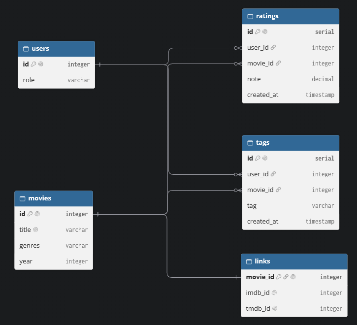

## Phase 1:
**Que représente une ligne de chaque fichier ?**
> movies : Une ligne par film
> ratings : Une ligne par avis laissé par un utilisateur
> tags : Une ligne par tag ajouté par film par utilisateur
> links : Une ligne par film (relie l'id interne aux id imdb et tmdb)

**Les 610 utilisateurs de `ratings.csv` sont anonymes : en ferez-vous des comptes de l'application, et s'ils n'ont pas de mot de passe, peuvent-ils se connecter ?**

**Structure DB (dbdiagram.io)**

